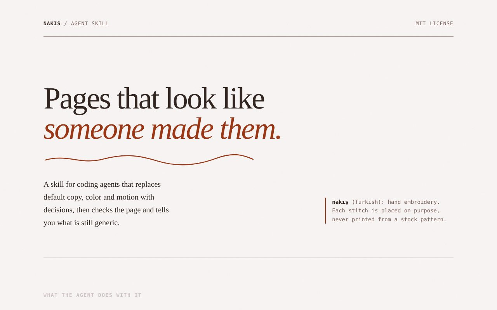

# skills

Agent skills for coding agents. Each folder is one skill: a `SKILL.md` file the agent reads,
plus the scripts and references it needs. Everything runs on your machine.
No servers, no keys, no accounts, no model calls inside the scripts.

| Skill | What it does |
|---|---|
| [`nakis`](nakis/) | Makes web pages look and read hand-made instead of machine-generated: copy, color, type, motion, and a local audit. |

---

## nakis

*Nakış* is Turkish for hand embroidery: every stitch placed on purpose, never printed from a stock pattern.

Generic pages are not ugly. They are built from defaults: the first font that comes to mind,
a violet gradient, three equal cards, a headline that could sell anything. `nakis` teaches the agent
to replace each default with a decision, and gives it a script that checks the result.

**Live page:** [beratboga.me/nakis.html](https://beratboga.me/nakis.html) · **Write-up:** [beratboga.me/#/blog/nakis](https://beratboga.me/#/blog/nakis)

| Before (score 0) | After (score 100) |
|---|---|
|  |  |

Both pages are in [`nakis/examples`](nakis/examples/). Run the audit on them yourself.
The first page was written to fail on purpose, so treat the comparison as a demonstration, not a benchmark.

### Tested blind

The test was run by the author together with AI agents. The same brief went to two fresh agents, one with the skill
and one without, and a third agent judged
the pages without knowing which was which. Two briefs (English and Turkish), three rounds in Turkish and two in English, the skill revised after each round.

- **Invented facts:** pages built without the skill made up 6–16 claims the brief never gave, depending on the round.
  In the last round, pages built with it had 0 (English) and 2 small, flagged inferences (Turkish).
- **Outside files:** one page built without the skill loaded fonts from another server; none built with it did.
- **Looks:** the judge preferred the skill's English pages in both rounds. In Turkish the result was mixed: the skill's page won the first round, and in the next two the page built without
  the skill was judged warmer and more crafted, while the skill's page was more accurate but plainer.
- **The score** barely separated them: pages built without the skill already scored 84–95.

It is a small test with a model as the judge. Treat it as a first look, not a benchmark.

### What the agent does with it

1. **Reads the brief** before writing code: page type, reader, one main action, three tone words.
2. **Writes the copy first**, in English or Turkish. Stock phrases, mirror sentences and translation smell
   are rewritten, and every factual claim must point back to the brief. Optional details that are missing are left out.
3. **Builds a palette** from one seed color, with tinted neutrals and checked contrast.
4. **Adds one moment of motion** that stops completely when the reader prefers reduced motion.
5. **Audits the page** with a local script and fixes what it finds.

### Install

Copy the `nakis` folder into the skills folder your agent reads. Most agents that support the open
skill format look in a `skills` folder inside their configuration directory, either in your home
directory (for all projects) or in the project itself (for one project). Check your agent's
documentation for the exact path.

```
your-skills-folder/
└── nakis/
    ├── SKILL.md
    ├── references/
    ├── scripts/
    ├── assets/
    └── examples/
```

Then ask your agent for a page, or for a review of a page you already have:

> Build a one-page site for my ceramics studio. Use the nakis skill.

> Review index.html with nakis and fix what it finds.

### Use the scripts on their own

Requires Python 3.8 or newer. No packages to install.

```bash
# Score a page from 0 to 100 and list what to fix
python3 nakis/scripts/audit.py path/to/index.html
python3 nakis/scripts/audit.py path/to/index.html --json
python3 nakis/scripts/audit.py path/to/index.html --lang tr
python3 nakis/scripts/audit.py path/to/index.html --min-score 85   # exit code 1 if below

# Build a readable palette from one color
python3 nakis/scripts/palette.py "#9a3412"
python3 nakis/scripts/palette.py "#9a3412" --mode dark
python3 nakis/scripts/palette.py --check "#777777" "#ffffff"
```

### What the audit checks

| Area | Checks |
|---|---|
| Copy | stock phrases, inflated verbs, empty adjectives, mirror sentences, Turkish translation smell, generic buttons, decorative emoji, everything in threes, title case, colon headings, question openers and question headings, dash overload, flat sentence rhythm, repeated lines and numbers, filler text, placeholders left on the page |
| Visual | violet-blue default gradients, gradient text, glass panels, identical large corner radius, shadows everywhere, centered everything, too many colors, fonts that are not bundled |
| Motion | missing reduced-motion support, infinite loops, `transition: all`, animated layout properties, too many animations, drawn lines that cannot draw |
| Accessibility | text contrast (resolves CSS variables), removed focus outlines, missing focus styles, `lang`, viewport, image `alt`, one `h1`, external files |

The score is a guide, not a grade. The final checklist in
[`nakis/references/checklist.md`](nakis/references/checklist.md) covers what a script cannot judge.

### Ground rules the skill follows

- Local only: no external fonts, CDNs, stock images or network calls.
- No borrowed identity: it does not name or imitate real brands, people or products.
- No invented facts: numbers, clients and quotes come from you.
- Accessible by default.
- Quality, not disguise: the goal is a better page, not hiding how it was made.

### Run the tests

```bash
python3 -m unittest discover -s tests -v
```

### Contributing

Pattern lists live in [`nakis/scripts/patterns.json`](nakis/scripts/patterns.json) and are explained in
[`nakis/references/copy.md`](nakis/references/copy.md). Keep both in sync. Every new check needs a test.

---

## Türkçe

`nakis`, kodlama ajanlarının ürettiği web sayfalarını şablon gibi değil, elle yapılmış gibi gösteren bir skill.
Metni (Türkçe ve İngilizce), renkleri, tipografiyi ve animasyonları ele alır, sonra yerel bir script ile
sayfayı 0–100 arası puanlar. Türkçe metinlerde hazır kalıpların yanında çeviri kokusunu da yakalar:
gereksiz edilgen yapılar, "-mektedir" yığını, "destek sağlamak" gibi isim fiiller.

Kurulum: `nakis` klasörünü ajanınızın skills klasörüne kopyalayın. Sunucu, anahtar ya da internet bağlantısı gerekmez.

---

## License

[MIT](LICENSE)
